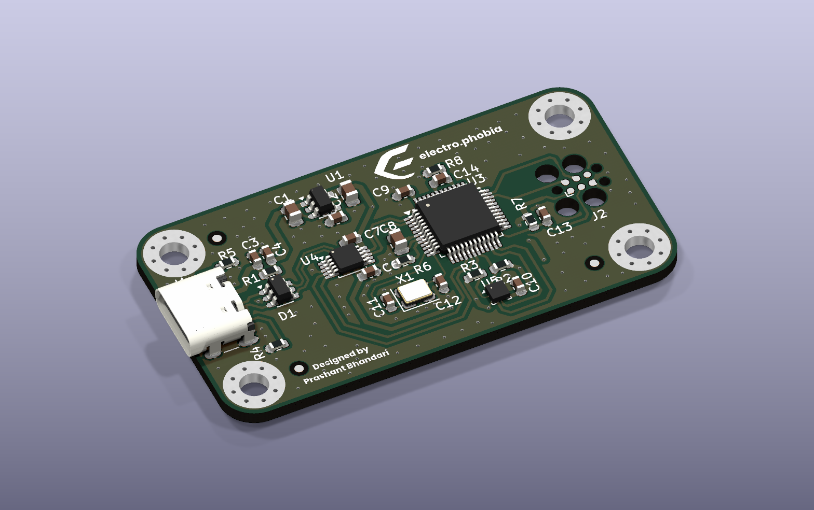

# MSPM0G3507 Development Board

A compact USB-C development board for TI's **MSPM0G3507** (Arm Cortex-M0+,
80 MHz, 128 KB flash, 32 KB SRAM), with an on-board USB-to-UART bridge, a
3-axis accelerometer and a Tag-Connect SWD footprint.



Full write-up: <https://bhandari-prashant.com.np/projects/mspm0-board>

## At a glance

| | |
| --- | --- |
| Size | 53 × 28 mm, 2-layer, 1.6 mm FR-4, 4 × M3 holes, fiducials |
| Power | USB-C (5.1 kΩ CC pull-downs) → SPX3819 3.3 V LDO |
| USB | CH340E USB-UART on UART0, with RTS/CTS; USBLC6-2SC6 ESD protection |
| Sensor | LIS2DH accelerometer on I²C0, INT1/INT2 to the MCU |
| Clock | 8 MHz crystal on HFXIN/HFXOUT; 100 kΩ on ROSC |
| Debug | SWD + NRST on a TC2030 Tag-Connect footprint (no header) |

## MCU pin map

| Signal | MSPM0 pin | Goes to |
| --- | --- | --- |
| UART0 TX / RX | PA0 / PA1 | CH340E RXD / TXD |
| UART0 RTS / CTS | PA8 / PA9 | CH340E CTS / RTS |
| I²C0 SDA / SCL | PA10 / PA11 | LIS2DH |
| INT1 / INT2 | PB8 / PB9 | LIS2DH interrupts |
| SWDIO / SWCLK | PA19 / PA20 | TC2030 |
| HFXIN / HFXOUT | PA5 / PA6 | 8 MHz crystal |
| ROSC | PA2 | 100 kΩ to GND |

## Project files

```
mspmo-baord/
├── mspmo-baord.kicad_pro   open this in KiCad
├── mspmo-baord.kicad_sch   schematic
├── mspmo-baord.kicad_pcb   layout
├── MSPM0.kicad_sym         custom MCU symbol (referenced by sym-lib-table)
├── bom/ibom.html           interactive BOM, open in a browser
├── fab/
│   ├── mfr/                Gerbers + drill files
│   ├── mspmo-baord.csv     BOM with LCSC part numbers
│   └── posfile/            pick-and-place positions
├── mfr.zip                 fab/mfr zipped for upload
└── images/                 renders used in this README
```

## Ordering

Upload `mfr.zip` to the board house. For assembly, use `fab/mspmo-baord.csv`
(BOM) and `fab/posfile/mspmo-baord-all-pos.csv` (CPL).

## Tools

KiCad 10. Renders made with `kicad-cli pcb render`.
